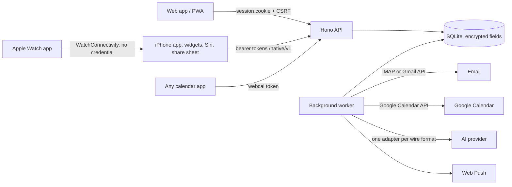

# Architecture

## Pieces

| Path | What it is |
| --- | --- |
| `server/` | Hono on Node 22: API, web app hosting and the background worker (one process by default) |
| `web/` | React 19 + Vite web app served at `/dashboard/`, installable as a PWA |
| `packages/contracts/` | Zod schemas shared by server and web: the public API shapes |
| `ios/` | SwiftUI app with widgets, a share extension and an Apple Watch app (MPL-2.0) |
| `deploy/` | Container entrypoint, installer, Caddy/Tailscale configs, cloud-init |

## Server layout

| `server/src/...` | Responsibility |
| --- | --- |
| `index.ts`, `config.ts`, `runtime.ts`, `cli.ts` | Start-up, configuration, first-run defaults, admin commands |
| `app.ts`, `routes/` | HTTP boundary: authentication, validation, response shapes |
| `auth/` | Built-in accounts, sessions, CSRF, native tokens, optional Cloudflare Access |
| `settings.ts` | Encrypted settings edited in the web app; environment overrides |
| `llm/` | Provider-neutral model interface and adapters (OpenAI Responses, Anthropic Messages, OpenAI-compatible) |
| `ai/` | Prompts and model-facing features: extraction, assistant agent, daily overview, knowledge upkeep |
| `sync/` | Email (IMAP, Gmail) and Google Calendar ingestion |
| `services/`, `repos/`, `domain/` | Household features and database access |
| `jobs/` | Durable job queue, scheduler and worker loop |
| `db/migrations/` | Ordered SQL migrations, applied at start |

## Rules that keep it safe

- **One household per account, many per server.** Every query is scoped by member and
  household; a plan is private to its owner until shared.
- **Actors come from authentication only.** Routes derive the member from the session or
  token. The model never chooses who acts, which credentials to use, or what to share.
- **Model output is untrusted.** Every response is parsed against a strict schema, checked
  against source evidence and privacy rules, and can only produce suggestions; writes to
  calendars happen only after a person approves.
- **Stable error codes.** Provider and mailbox errors are reduced to codes such as
  `AI_RATE_LIMITED` or `IMAP_AUTH_FAILED`; provider text never reaches logs or clients.
- **Durable work.** Email polling, extraction, reminders and briefs run as leased jobs in
  SQLite with retries; results from a stale lease, a disconnected mailbox or a removed
  member are discarded.
- **Encryption at rest.** Email evidence, plan facts, lists, tokens, passwords and keys are
  AES-256-GCM envelopes keyed from the server secret.

## Email and calendar

Email connections (Gmail via OAuth, or IMAP via an app password) share one table and one
pipeline: poll → normalize to evidence → extraction job → suggestions. IMAP keeps a
`UIDVALIDITY:UID` cursor and opens the mailbox read-only. The calendar feed publishes
saved plans as iCalendar; Google Calendar, when connected, is read for the agenda and
written only for approved plans.

## AI

`LlmHub` resolves the configured provider and model per call, so changing AI settings in
the web app applies without a restart. Roles: `main` (assistant, briefs, knowledge),
`email` (extraction; defaults to main), optional `review` (relevance gate), and
`transcribe`. Adapters report capabilities (images, PDFs, tools, web search,
transcription) and features degrade gracefully when one is missing.

## Features

Behavior and code pointers for each feature:

- [Ask the planner](features/assistant.md)
- [Email suggestions](features/email-suggestions.md)
- [Morning brief](features/morning-brief.md)
- [Household knowledge](features/household-knowledge.md)
- [Notifications](features/notifications.md)
- [Home and the Linen & Teal design](features/home-design.md)
